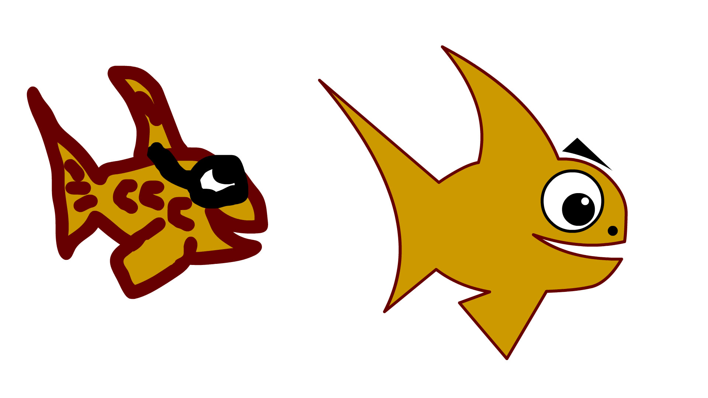

# A1 - Drawing vs Shapes

## Assignment 1

In this simple assignment you'll be building a simple object like a fish using the paint brush tool and a second fish using the shape tool. The objective is to compare the two methods of drawing/creating objects as well as give you some familiarity with the workspace.

## Pro Tips

1. When using the Shape tool (rectangle or oval) make sure that the stroke is off so that the shape is solid without an outline. This makes it easier to overlap objects without them being separated by a thin line. If you want to add an outline you can do it at the end of the process using the Ink Bottle tool.
2. If you use the Object Drawing Mode and Snap to Objects options you can layer and manipulate your overlapping shapes without joining them.
3. Use the Direct Selection tool (black triangle arrow) to bend straight lines and adjust corner points.
4. Shift+Alt key allows you to click and drag to duplicate an object.

Refer to the first video [Drawing in Animate](https://creativecloud.adobe.com/discover/learn/animate/beginner/graphic-design/drawing/drawing-in-animate-cc) for an overview of basic drawing methods using shapes.

## When You're Done

Once you've completed the two illustrations you'll export the "animation" as a .jpg and upload it into Canvas. Also make sure to save your work in your student folder in the M drive.
