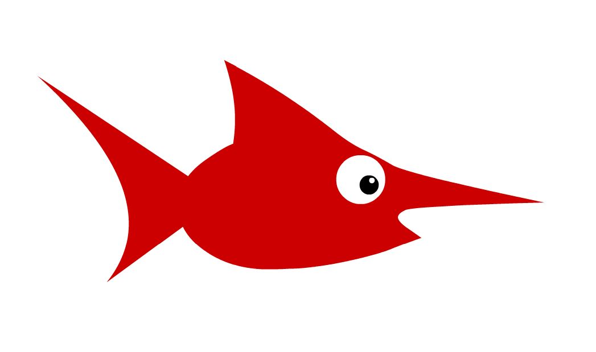

# A2 - Creating Multiple Objects

## Assignment 2

Open up a new Animate file and create a document is 1920 px x 1080 px.

In this assignment you'll be building **at least 6  different types of fish** (hey - if you want to do something different for your first animation feel free to do so... but fish are pretty easy) and **4 other objects**  that you can use in your first animation. The objective is to develop a range of objects that you can animate and give you some familiarity with how the library works.

## Refresher

1. When using the Shape tool (rectangle or oval) make sure that the stroke is off so that the shape is solid without an outline. This makes it easier to overlap objects without them being separated by a thin line. If you want to add an outline you can do it at the end of the process using the Ink Bottle tool.
2. If you use the Object Drawing Mode and Snap to Objects options you can layer and manipulate your overlapping shapes without joining them.
3. Use the Direct Selection tool (black triangle arrow) to bend straight lines and adjust corner points.
4. Shift+Alt key allows you to click and drag to duplicate an object.
5. Once you have finished a fish draw a box around it with the Selection tool (be careful not to miss any of the extra parts of the fish or include other objects in your selection) and then use Modify&gt;Convert to Symbol to add it to the library.

Refer to the first video [Drawing in Animate](https://creativecloud.adobe.com/discover/learn/animate/beginner/graphic-design/drawing/drawing-in-animate-cc) for an review of basic drawing methods using shapes.

## When You're Done

Once you've **completed the ten illustrations** you'll save the file as assignment.fla file in an A2 folder your student folder in the M drive. Then leave a comment that the project has been finished in Canvas.
