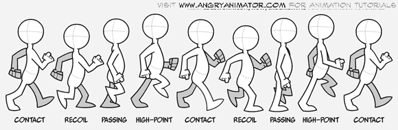

# A7 - Walk Cycle

One of the most challenging tasks of an animator is making a walk cycle. Using Adobe Animate, there are a number of different ways to approach this challenge.

We're going to use the approach of animating the cycle inside a graphic symbol, similar to the approach we used in A5 - Face Expressions. Using this method, the movement is inside the symbol and if done correctly you can use the looping feature of the symbol to create a character that can walk across the screen. Combining that with a moving background can create a relatively realistic sense of motion.

This short video provides an overview of a basic walk cycle and the important steps in the cycle.

[youtube]https://www.youtube.com/watch?v=2y6aVz0Acx0[/youtube]

## Key Requirements

- A developed character (i.e. not a stick man) who walks across the stage in 10 seconds.
- The character's arms and legs should move.
- Optional - add a head bob.

## What to Do

1. Create a folder in M (Media):\ [INGRAM]\2020\2D Animation\Your Name\A7
2. Create a new HTML5 Canvas in Adobe Animate, change the size of the Stage from the default to something that is a little larger – 1920 px by 1080 px works well. You might want to save it right away.
3. Save the .fla file in your student folder.
4. Create a simple object on the stage and convert it into a Graphic Symbol - this is where you're going to build your walk cycle.
5. From the Library, open up your Graphic Symbol. The next steps will be completed in your Graphic Symbol.
6. Create layers for the different parts of the character's body - head, torso, right arm, left arm, right leg, left leg
7. Draw a side profile of your character. Note that you'll only have to draw one leg and one arm in this step. Use Object Drawing mode to keep the parts separate. Switch back to Merge Drawing mode if you want to combine shapes, then use Modify&gt;Combine Objects&gt;Union to convert that to a single object.
8. To create the second set of arms and legs you can either draw them or copy and paste the frames that you've already done.
9. Refer to the image of the walk cycle above. Create the first pose in the walk cycle. Then insert new keyframes (2 frames/position should work well) and create the next pose in the cycle. Repeat. Note how the shape of the foot changes. A detailed description of the process can be found at [The Angry Animator](https://www.angryanimator.com/word/2010/11/26/tutorial-2-walk-cycle/).
10. Select all of the frames for left arm and left leg and in the Properties module select Tint, choose Black as the colour, and set the strength to 30% - this creates a shadow effect.
11. Once you've got the movement looking natural, bring the symbol onto the stage. Create a simple background and a span of 10 seconds. Have the character walk across the stage in that span of time.

## Pro Tips

- It might be simpler to work with one leg/foot at a time.
- Use Onion Skin and Edit Multiple Frames to change multiple frames at the same time.
- Add more frames in the Graphic Symbol to smooth the motion out.
