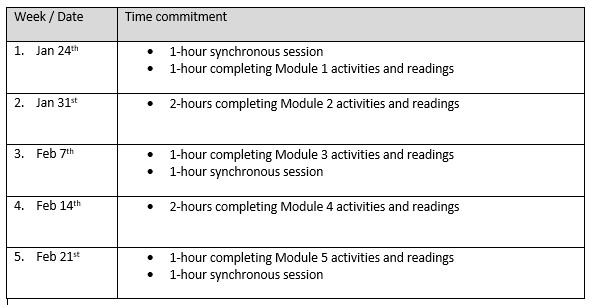

# Syllabus

### ITO: Introduction to Teaching Online   
Online   
10 hours

**ADD INSTRUCTOR IMAGE HERE**

**INSTRUCTOR**   
**Add instructor name and contact information here**  

 **OFFICE HOURS:** Held weekly over Zoom for the 5 weeks – Drop in for a chat / Q&A/ feedback / sounding board

Access the Zoom link from the course calendar, or the Zoom meetings link in the course navigation menu   
 Drop ins are scheduled every Thursday from 3 - 4pm  

 **CONTACT** me: via the Canvas Inbox. Expect replies within 24hrs on weekdays and 48hrs at the weekend.

**COURSE DESCRIPTION**

This non credit course is designed to provide you with a foundation for teaching online. ITO is a 5 week mostly asynchronous, course with three synchronous sessions built in. At the end of this course you will have started to plan your online course by creating course outcomes, module learning objectives, and selecting appropriate assessment strategies and learning materials.

This course addresses the following Educator Commitments from our Learning Charter:

- Select and Utilize methods that are effective in helping students achieve the learning outcomes of a course.
- Provide a clear indication of what is expected of students in a course or learning activity, and what students can do to be successful in achieving the expected learning outcomes.
- Engage in meaningful conversations about their practices with others.

**COURSE LEARNING OUTCOMES**

By the end of this short course you will have completed the Backward planning template for your online teaching module. This template will include clearly defined learning outcomes and objectives that are aligned with active learning experiences and assessment strategies that demonstrate student learning.

1. Considering the online context, create and organize learning outcomes.
2. Select and use effective online formative and summative assessment strategies to determine student success in achieving the expected learning outcomes.
3. Select and use effective online instructional approaches and align with outcomes.
4. Reflect on your experiences as an online learner and show how it will influence your online teaching.

**COURSE FORMAT**

This is a 10 hour, mostly asynchronous course, designed to be covered over 5-weeks.

There are three 1 hour **synchronous** sessions built in.

- The first is in week one, where we meet, greet and introduce ourselves. We will go over the ITO course so you know where to find things and what to expect, and you will sign up to be discussion board moderators.
- The second is in week three. We will use this session to check-in and discuss progress or concerns to date.
- The final synchronous session will be held in the last week of the course. In this session you will be reflecting on your experiences as an online learner and share the implications this will have for your online practice.

The **asynchronous** part of the course is divided into 5 modules, each with its own discussion board. Since this is an online course most of our interactions will occur through discussion posts. Each discussion board has a series of questions for you to consider and answer. The idea with the discussion boards is to build in some collaboration and connection. It is a place to share your thoughts and experiences. The time commitment for these posts **should not** take up the entire two hours allotted for each module and that is why the initial posts are required to be one paragraph in length, and you are required to comment or respond to one other post.

- Module 1 - **Pre-session activities.**
  - Discussion board subject **Share your online learning experiences** (*Whole class)*
- Module 2 - **Considering the online context, create and organize course outcomes** 
  - Discussion board subject **How do you plan your courses -pre-assessment** (*Group activity*)
- Module 3 - **Select and use effective online formative and summative assessment strategies to determine student success in achieving expected learning objectives** 
  - Discussion board subject **Assessment strategies -pre assessment** (*Group activity*)
- Module 4 - **Select and use effective online instructional approaches and align with outcomes** 
  - Discussion board subject -**Instructional approaches -pre assessment** (*Group activity*)
- Module 5 - **Reflect on your experiences as an online learner and show how it will influence your online teaching**. 
  - Discussion board subject -**Reflections and Implications for practice -pre assessment** (*Whole class*)

**DATES AND TIME COMMITTMENT**

As this course is mostly asynchronous, it is up to you when you complete the readings and activities. Try to commit two hours per week to completing each module. If everyone is completing the course within the same time frame there is more opportunity for connection and collaboration in the online context.

***Create a version of this table in Word with the appropriate dates, save the image and add it to this document.***

---

***A note about discussion boards*.** Each week discussion board moderators will be monitoring the discussion boards (you will sign up for this in our first synchronous session). The moderators will be responsible for connecting people's ideas, asking questions and prompting for more detail if appropriate. In order for you to allocate your time appropriately, all discussion board posts should be submitted by the Wednesday of each week so that moderators can reply to posts by the Friday of each week.

***Module 1:*** This discussion board is for the whole class. You are asked to share your experiences with online teaching and learning. An important aspect of this discussion board is to identify any barriers you have about teaching online. This is important because you will be asked in the last discussion board to identify whether the barriers you identified have been removed after completing the ITO course.

***Modules 2, 3 & 4.*** These modules all start with pre-assessment discussion boards. You will be divided into groups for these discussion boards to keep the amount of time spent on these boards manageable. The idea behind these boards is for you to assess and reflect on what you already know about the topic being covered so that you can build on it throughout the modules.

***Module 5.*** The last discussion board is for the whole class. You are required to reflect on the ITO course. You will be asked to share your reflections and implications for your practice with the other participants. You decide what and how you would like to share these reflections.

---

**ORGANIZATION & STRUCTURE**

- **Canvas course**

***Course navigation menu***

The course navigation menu appears on the left hand side of the screen when you open the ITO course. It has been curated to include direct links to two Blog sites: DEU and Educatus. These Blogs contain information about teaching and learning and are useful resources which you can explore at your leisure.

***Modules***

The course content has been chunked and sequenced into modules. There are 5 modules in total. Each module contains course content for you to review, provides active learning experiences for you to practice and get feedback on, as well as extra resources for you to use if you choose.

***Additional resources***

You will find hyperlinks embedded within some pages, please follow these links for further information. For additional information about a topic you will find a **resources** section within each modules. There are **optional** and are included so that you can easily find out more information about a topic that interests you.

- **Support & Feedback**

***Synchronous session #2***

Sometimes talking through your plan (having a sounding board) is helpful.  It is offered halfway through the course to allow you to share and discuss your progress, provide peer feedback to allow for refinement and improvement of your work to date. It has been intentionally designed as an opportunity for you to connect and interact because it is easy to feel isolated in an online environment.

***Drop in sessions***

Weekly drop in sessions have been scheduled every Thursday from 3-4pm. To access these sessions, simply click on the Zoom Meetings link in the course navigation menu and join the meeting from there.

***"I need help" - discussion board***

It is important for you to feel supported, particularly in an online environment, asynchronous environment. This discussion board has been set up so that you can reach out to the instructor and other participants at a time that is helpful to you. If you have a question, or just need someone to bounce ideas off of, this board is a good place to start.
