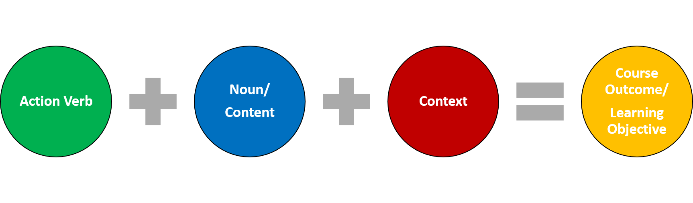

# Begin with the end in mind - Backward planning

## Structuring your online course

Online courses must be well structured. If you think about it, semesters and credit courses are some of the structures already in place that you work within. You are likely already very familiar with structuring lessons or labs for your face-to face classes. For online courses, structure is even more important.  An online course that is well structured steers students through the course, and clearly emphasizes **what** students are expected to know and do, **how** they will be assessed and **when** they have to do it by. A well structured course means that students can find information easily, expectations are clearly defined and there is strong  alignment between instruction and assessment.

The first step towards a well structured online course is to begin with the end in mind. This means, first, you have to be able to articulate what it is you want your students to know or be able to do or demonstrate after taking your course. Designing your courses  backwards ensures the intentional connection between learning objectives, assessments and activities. This connection is also known as [alignment](https://words.usask.ca/gmcte/2019/12/19/all-aligned-instruction/).

[Understanding by Design](https://cft.vanderbilt.edu/guides-sub-pages/understanding-by-design/) is a template designed by Wiggins and McTighe they say

*“Our lessons, units, and courses should be logically inferred from the results sought, not derived from the methods, books, and activities with which we are most comfortable. Curriculum should lay out the most effective ways of achieving specific results… in short, the best designs derive backward from the learnings sought.”*

## Backward planning

This video explains why Backward planning is the best way to plan your course (5 mins)

[youtube]https://www.youtube.com/watch?v=OjzQpQ9nlu4[/youtube]

## Begin with the end in mind - articulating course outcomes and learning objectives

When you begin designing your online course (or any course for that matter) the first step is to articulate the course outcomes. A course outcome is broad in scope and specifies what a student will know or be able to do or demonstrate by the end of your course. Course outcomes should be broad enough that they can be broken down into module learning objectives.

Course outcomes and learning objectives should clearly communicate how students can be successful in your course. When writing course outcomes and learning objectives you need to have the following questions in mind:

1. **What do I want students to learn or be able to do? Action verb**
2. **Can I connect a specific task or activity to the objective, so that learners can demonstrate competence? Noun (content)**
3. **What context can I provide to tell students how the objective will be assessed or observed Context**

Answering these questions will result in clearly written course outcomes and learning objectives. You should be able to identify three distinct parts:

- **Action verb –** **describes the level of thinking /doing a student will demonstrate**
- **Noun (content) –describes what the student will know**
- **Context – describes the conditions of the assessment**

## Comparing Outcomes and Objectives

**Course Outcomes**

**Module Learning Objectives**

- should specify what a student must know and be able to do at the end of a course
- should be broad in nature so that they can be broken down into module learning objectives
- should be written at a higher [Blooms level](https://courses.dcs.wisc.edu/design-teaching/PlanDesign_Fall2016/2-Online-Course-Design/2_Learning-Objectives-Alignment/6_objectives_blooms-taxonomy.html) than module learning objectives

- should have a narrower focus than course outcomes
- should be measurable, specific and relevant
- must be aligned with course outcomes
- help you select and organize content
- help you determine appropriate assessments and instructional strategies
- help students direct their learning efforts
- help students monitor their own progress

Course outcomes and learning objectives are important because all teaching and learning activities, feedback and assessments should be in  [alignment](https://words.usask.ca/gmcte/2019/12/19/all-aligned-instruction/)  with them.

---

This video explains the difference between course outcomes and learning objectives and provides examples of each. ( ~ 7 mins)

> [Open interactive activity](https://openpress.usask.ca/tonim-test/wp-admin/admin-ajax.php?action=h5p_embed&id=7)

## ✍Activities

Read each of the learning objectives below and click on the action verb in each sentence.

> [Open interactive activity](https://openpress.usask.ca/tonim-test/wp-admin/admin-ajax.php?action=h5p_embed&id=9)

---

Evaluate the following outcomes and objectives. Once you have read each statement, click on the arrow for more information.

> [Open interactive activity](https://openpress.usask.ca/tonim-test/wp-admin/admin-ajax.php?action=h5p_embed&id=5)

## Resources

[Learning objectives.](https://openpress.usask.ca/ideabook/part/learning-objectives/) This page from the ideas book talks about learning objectives as statements that define the knowledge, skills, or attitudes that students should achieve through participation in a learning experience and gives examples of SMART learning objectives.

[How can Bloom's Taxonomy help with writing learning objectives?](https://courses.dcs.wisc.edu/design-teaching/PlanDesign_Fall2016/2-Online-Course-Design/2_Learning-Objectives-Alignment/6_objectives_blooms-taxonomy.html)  On this site, you will find information about how to write learning objectives at different cognitive levels according to Blooms taxonomy, and a presentation that uses excerpts from the show the "Big Bang Theory" to give examples of these six cognitive levels.   At the bottom of the page there is a built in Quiz and you can choose between different quiz types to test your understanding.

Blooms_taxonomy_action_verbs.pdf This document lists action verbs that can be used for each cognitive level of Bloom's taxonomy.

[Revised Blooms Taxonomy](https://openpress.usask.ca/ideabook/chapter/revised-blooms-taxonomy/) . This page from the Ideas book and summarizes Blooms levels and provides additional links for further exploration.
