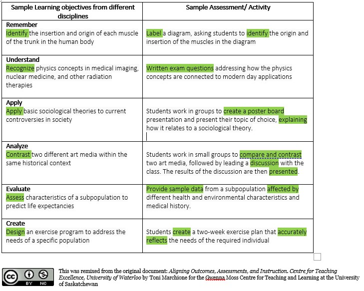
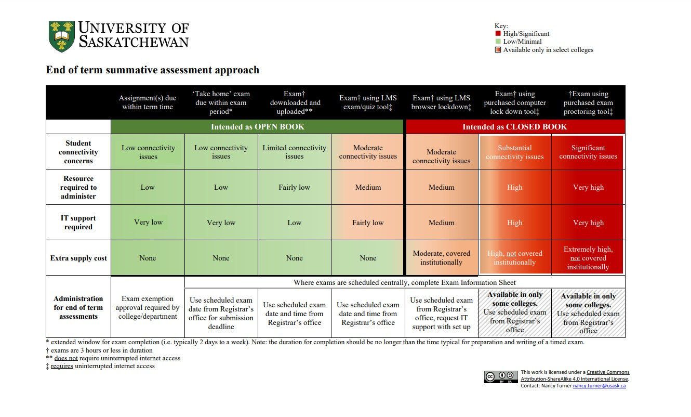

# Assessments and activities that align with learning objectives.

## Gathering evidence of student learning and understanding

Assessing student learning is an essential component of effective online teaching. When thinking about assessments in your online course it is important that they align with your course outcomes and learning objectives. You need to ensure that you are assessing exactly what it is you intend your students to learn.

If one of your course outcomes is **"At the end of this course students will create and organize learning outcomes"** the best way to assess whether students can in fact create and organize learning outcomes is to actually get them to do just that. If this outcome was assessed with a multiple choice exam, the instructor would not have any evidence of the students achieving this outcome.

If you are wondering what well aligned assessments look like, this table shows examples of the types of activities that can be used to assess different types of learning objectives.

     [https://creativecommons.org/licenses/by-nc/4.0/](https://creativecommons.org/licenses/by-nc/4.0/)

More examples of how to align assessments and activities to learning outcomes using Blooms taxonomy are found on this document. Double click to download it.

---

This video describes how assessment strategies should ensure alignment between course outcomes, module learning objectives, materials and activities and assessments to help students meet their learning goals. (~9 min)

[youtube]https://www.youtube.com/watch?v=XON_-XfXtZ8[/youtube]

*Note that where the video mentions the tools available in  Moodle, these tools are also available in Canvas.*

## Comparing formative and summative assessments

Formative and summative assessments both assess student learning. The difference between the two is that formative assessments help students learn and practice the knowledge, skills and competencies of your course and summative assessments assess student performance at the end of a learning experience. The differences lie in **when**, **why** and **how** you would approach each type of assessment.

Comparing the when, why and how of formative and summative assessments.

**Formative** *(assessments **for** learning)*

**Summative** *(assessments **of** learning)*

**When**

- Throughout the course (as students are navigating courses online and on their own)

- At the end of a learning experience (lesson, module or course)

**Why**

- Identify gaps, check understanding and improve learning
- Opportunities to practice knowledge, skill or proficiency in a low stake environment
- Increases engagement and motivation

- Collect evidence of student knowledge, skill or proficiency

**How**

- Build in self checks and quizzes
- Utilize discussions and reflections

- Final exams or Presentations
- Projects or Research papers

## Considerations for summative assessments

Summative assessments provide evidence of student learning. In face-to-face classes summative assessments are typically in the form of a timed, final exam. Using the same type of summative assessment in an online environment needs some extra consideration. Will students need an uninterrupted internet connection? Is IT support required? View the graphic below which shows how these factors affect different types of summative assessment approaches.

The table below outlines seven options to consider for end of term summative assessment, highlighting the impact the varying options have in relation to student connectivity (access/bandwidth), administrative and IT support requirements, and extra costs.

## Academic Integrity

The International Centre for Academic Integrity defines academic integrity as "*a commitment, even in the face of adversity, to six fundamental values: honesty, trust, fairness, respect, responsibility and courage*".

Students can learn about academic integrity through educators, colleges and university processes. The best way to reduce academic misconduct is to prevent it. Designing resistant assessments, modelling appropriate behavior and teaching norms are all more effective at reducing academic misconduct than detecting it after it has happened.

Assessment design and course climate (including modelling and teaching) are two key categories that help [promote academic integrity](https://teaching.usask.ca/classes/promoting-academic-integrity.php#Ref1) in courses.

View this graphic to see how to design assessments with academic integrity in mind.

## Tips

- Use [authentic assessments](https://words.usask.ca/gmcte/2020/09/15/using-authentic-assessment-to-integrate-current-events-into-courses/) to help students connect what they are learning to current events encouraging them to apply what they have learned in a new situation. Authentic assessments can also minimize the possibility of academic misconduct. Read more about [Academic Integrity and Remote Teaching](https://words.usask.ca/gmcte/2020/03/18/academic-integrity-and-remote-teaching/).
- Use [reflections as evidence of learning](https://words.usask.ca/gmcte/2020/03/18/using-reflections-on-learning-as-assessments/)
- Utilize [peer-feedback](https://usask.cloud.panopto.eu/Panopto/Pages/Viewer.aspx?id=193df775-593d-432a-b4b1-ac0101657c60) to reduce instructor workloads. If there are multiple parts to an assessment have peers review and provide feedback at certain stages. This helps improve the quality of work students submit.
- Oral assessments can be used for assessment purposes. They can be in the form of a presentation, interview, or discussion. Oral assessments may take some advanced planning but they can assess a student's depth of knowledge and skills.

## ✍Activities

See what you know about formative and summative assessments by completing the following four questions.

> [Open interactive activity](https://openpress.usask.ca/tonim-test/wp-admin/admin-ajax.php?action=h5p_embed&id=12)

## Resources

Assessment-Tools-Activities.pdf This document is part of the DEtoolkit and has a list of assessment tools and activities.

[How Canvas supports learner centered assessment.](https://words.usask.ca/gmcte/2020/11/08/how-canvas-supports-learner-centred-assessment/) This Blog post outlines the Canvas tools available for providing feedback.

[Assessment and grading issues.](https://openpress.usask.ca/onlinelearning/chapter/chapter-9-assessment-issues/)  This page is from the Creating Online Learning Experiences book. Read the sections titled "Types of Assessment" and

"Suggestions for Assessment Practices".

[Transparent assessment](https://words.usask.ca/gmcte/2020/01/03/transparent-assessment/) - This page from the Gwenna Moss Blog outlines 5 techniques to make your assessments more transparent.

Feedback and Communication - This page explains why feedback and communication are important in an online environment and provides links to useful Canvas tools.

Effective rubrics - this page explains how students and instructors can use rubrics and also provides templates to build your own rubrics.
