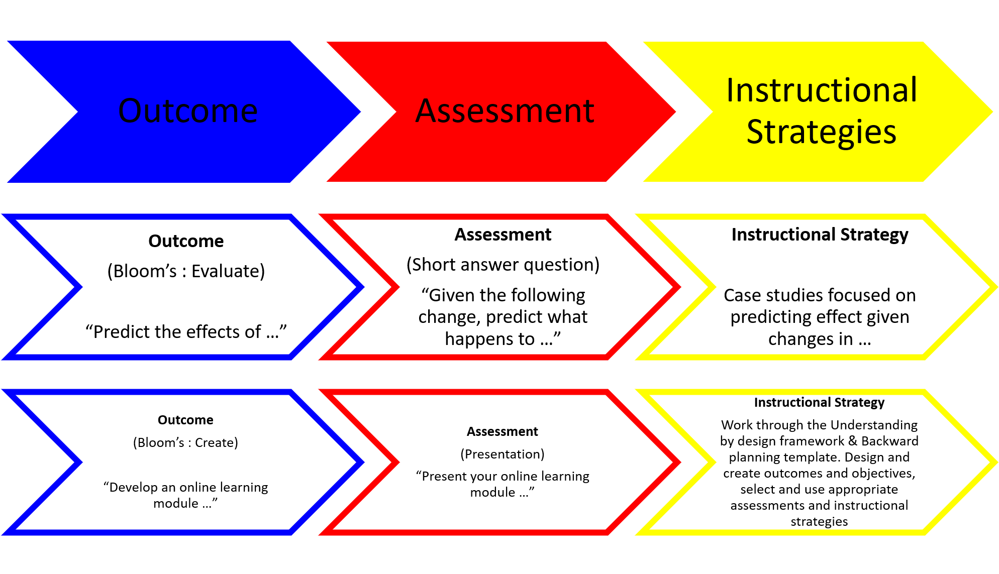
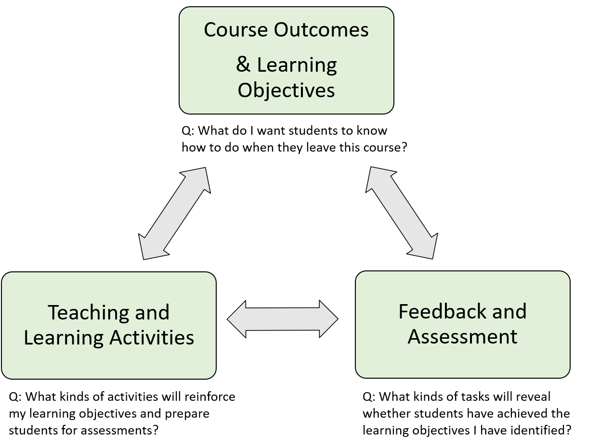

# Instructional strategies

## Selecting Instructional strategies that are aligned with course outcomes and objectives

Instructional strategies are the tools and techniques that Instructors use to design and facilitate learning. They can help students stay motivated, engaged and focused, as well as help them organize information and monitor and assess their own learning.

The instructional strategies that you choose to use in your online course must be aligned with your course outcomes and learning objectives.

There are 5 broad types of instruction that you could use to deliver your course outcomes. The one which is best for you depends on the type and level of your course.

Different instruction types and their descriptions.

**Instruction type**

**Direct Instruction** **(learn about)**

**Experiential Instruction (learn by doing)**

**Independent Instruction (make sense for yourself)**

**Interactive Instruction (learn by doing with others)**

**Indirect Instruction (think deeply)**

**Description**

An instructor presents information to students in a structured way.

Students engage with ideas, skills or problems through authentic experiences.

Students who work on their own and engage with the learning material at a deeper level.

Students engage with each other to share ideas and create content.

Students work on their own to connect new learning to their prior knowledge and deepen their learning.

**Examples**

- Lectures
- Videos
- Readings
- Demonstrations
- Presentations

- Case based learning
- Project based learning
- Problem based learning

- Graphic organizers
- Research
- Reflections
- Portfolios
- Blogs

- Discussions
- Group work
- Projects
- Debates
- Brainstorming

- Reflections
- Readings
- Problem based learning
- Graphic organizers

---

An example of how to align Instructional strategies to assessments and outcomes.

---

As you are designing your online course you may have started to wonder whether you should use asynchronous or synchronous activities to facilitate student learning. There are benefits and drawbacks to both.

## Alignment

Alignment - is important because it ensures that course outcomes, objectives, course materials and assessments are intentionally planned to help students achieve your course goals.

*A well structured course ensures that course outcomes and learning objectives are intentionally aligned with assessments and activities. As you design your course make sure you ask yourself the relevant questions.*

[Alignment video from LSU](https://youtu.be/1LAld8OVnBw) (just over 3 mins)

## ✍Activity

In this drag and drop activity, you have to align the instructional strategies with the outcomes and assessments.

&lt;/P 

> [Open interactive activity](https://openpress.usask.ca/tonim-test/wp-admin/admin-ajax.php?action=h5p_embed&id=17)

## Resources

[Active Learning strategies](https://teaching.berkeley.edu/active-learning-strategies) This resource from the Berkeley Centre for Teaching and Learning provides a list of active learning strategies.

Discussion forum activities This resource is part of the DEtoolkit and offers suggestions on different ways to use Discussion forums.

[Instructional approaches.](https://openpress.usask.ca/ideabook/part/instructional-approaches/) This chapter from the Ideas book gives many examples of Instructional approaches you could use in your course.

[Creating effective course activities](https://openpress.usask.ca/onlinelearning/chapter/chapter-6-creating-effective-course-activities/). This page from the Creating Online Learning Experiences talks about ways to incorporate active learning into courses.

[Elaborations on Canvas collaborations.](https://words.usask.ca/gmcte/2021/01/28/elaborations-on-canvas-collaborations/) A blog post about using Canvas collaborations to get students to work together.

Remote assessment activities.  This resource is part of the DEtoolkit and offers a list of assessments and activities with ideas of how to use them and considerations for their use.

Next steps - using the backward design template to design your online course was the first step. Once you have the rest of your course designed you can start putting it together in a Canvas module.
